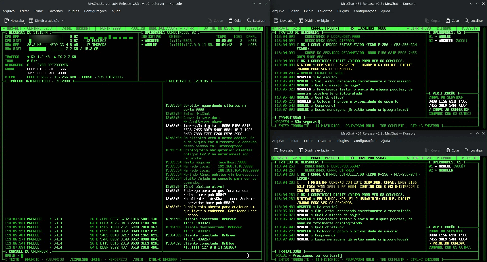

#  MrsChat

**MrsChat** é um aplicativo cliente que tem como objetivo se conectar a uma sala hospedada por um servidor MRS, pode ser adiquirido [neste meu outro repositório](https://github.com/FlaipyTheHost/MrsChatServer).

Criei este projeto inspirado em uma cena do filme **The Incredible Hulk (2008)** onde Bruce Banner se comunica com "Mr.Blue" de uma favela do Rio. Além da vontade de aprender como funciona a tecnologia cliente servidor na prática, com uso de sockets de rede.
# 

Captura do funcionamento de **MrsChat**:
# 

## Novidades da v2.3

- **Mensagens cifradas** até o servidor (AES-256-GCM, troca de chaves ECDH P-256 assinada pelo servidor). Exige o MrsChatServer v2.3.
- **Painel VERIFICAÇÃO** abaixo dos operadores, com a impressão digital da chave do servidor. Todos na sala devem ver o mesmo código, que também aparece na tela do servidor. Se o seu for diferente, sua conexão foi interceptada.
- O cliente lembra a chave de cada servidor e **recusa a conexão se ela mudar**. Se a troca for legítima (servidor reinstalado), confirme com o administrador e use `--confiar-nova-chave`.
- Comando `/chave` mostra a impressão digital completa.

A criptografia é entre você e o servidor, não ponta a ponta: o servidor decifra para repassar as mensagens (a tela dele mostra só os bytes cifrados).

## Novidades da v2.2

- **Tema militar** (padrão): terminal de fósforo verde dos anos 80, fundo preto, moldura dupla, rótulos em caixa alta no estilo teletipo e nomes como indicativos de chamada.
- Sequência de inicialização ao abrir (qualquer tecla pula).
- Cabeçalho com relógio em segundos, indicador de link piscando e, em janelas largas, o grupo data-hora militar (ex.: `281432P OUT 26`).
- Variante **âmbar** (`--tema ambar`) e o visual anterior em `--tema classico`.


## Novidades da v2.1

- **Interface em tela cheia**: cabeçalho com app, versão, sala, endereço e hora; histórico da conversa com rolagem; painel de integrantes à direita; caixa de mensagem embaixo.
- Painel de integrantes atualizado em tempo real (entradas, saídas e `/nick`).
- Tab completa nomes, PgUp/PgDn rola o histórico, ←/→/Home/End editam a mensagem.
- Ajusta-se ao tamanho da janela; em janelas estreitas o painel de integrantes some. Use `--simples` para a interface linha a linha.

## Novidades da v2.0

- **Conexão pela internet**: basta usar o endereço público que o servidor mostra com `--publico` (ex.: `bore.pub:41234`).
- **Interface de linha de comando** com opções (`--nome`, `--servidor`, `--senha`) e `--ajuda`. Se faltar algo, o programa pergunta.
- **Terminal sem piscar**: as mensagens chegam acima da linha de digitação sem apagar o que você está escrevendo.
- Histórico com ↑/↓, horário nas mensagens, cor por usuário e senha digitada com `*`.
- **Comandos**: `/usuarios`, `/msg`, `/nick`, `/me`, `/limpar`, `/ajuda`, `/sair`.
- Aceita endereços `host:porta`, `[IPv6]:porta` e `tcp://host:porta` (formato de alguns túneis).
- Continua **compatível com o MrsChatServer v1.0** (os comandos de sala exigem o servidor v2).

## Instalação

É necessário ter o **.NET 8 ou mais novo** (o app usa a versão mais nova que encontrar, então o .NET 10 também serve).

**Windows:** instale o runtime pelo [site da Microsoft](https://dotnet.microsoft.com/pt-br/download/dotnet/8.0) e execute o `MrsChat.exe` das [releases](https://github.com/FlaipyTheHost/MrsChat/releases/).

**Ubuntu/Mint/Debian:**
```
sudo apt install dotnet-runtime-8.0
```

**Fedora:**
```
sudo dnf install dotnet-runtime-8.0
```

## Uso

```
unzip MrsChat_x64_Release_*.zip
dotnet MrsChat.dll --nome MrBlue --servidor 192.168.0.10:9000
```

| Opção | Descrição |
|---|---|
| `-n`, `--nome <nome>` | Seu nome na sala |
| `-s`, `--servidor <endereço>` | Ex.: `192.168.0.10:9000` ou `bore.pub:41234` |
| `--senha <senha>` | Senha da sala, se houver (sem ela, o programa pergunta) |
| `-t`, `--tema <nome>` | `militar` (padrão), `ambar` ou `classico` |
| `--sem-cor` | Desliga as cores |
| `--sem-cripto` | Conecta sem criptografia (só para servidores antigos) |
| `--confiar-nova-chave` | Aceita a chave do servidor mesmo que tenha mudado |
| `--simples` | Interface linha a linha, sem painéis |
| `-h`, `--ajuda` | Mostra a ajuda |

A forma antiga `dotnet MrsChat.dll <nome_usuário> <ip:porta>` continua funcionando, assim como rodar sem parâmetros usando o `MrsChat.conf`:

```
nome=MrGreen
servidor=localhost:9000
senha=
tema=militar
```

## Comandos no chat

| Comando | Descrição |
|---|---|
| `/usuarios` | Quem está online |
| `/msg <nome> <texto>` | Mensagem privada |
| `/nick <novo nome>` | Troca seu nome |
| `/me <ação>` | Ex.: `/me acenou` |
| `/chave` | Impressão digital completa da chave do servidor |
| `/limpar` | Limpa a tela |
| `/sair` | Sai do chat (ou Ctrl+C) |

## Teclas na tela cheia

| Tecla | Ação |
|---|---|
| Enter | Envia a mensagem |
| ↑ / ↓ | Mensagens enviadas antes |
| PgUp / PgDn | Rola o histórico |
| Esc | Limpa a mensagem; com ela vazia, volta ao fim da conversa |
| Tab | Completa o nome de um integrante (de novo para o próximo) |
| ← → Home End | Movem o cursor; Ctrl+W apaga uma palavra |
| Ctrl+L | Redesenha a tela |
| Ctrl+C | Sai |

O painel de integrantes precisa do MrsChatServer v2. Com o servidor v1 ele mostra só quem entrou depois de você ("Vistos").
